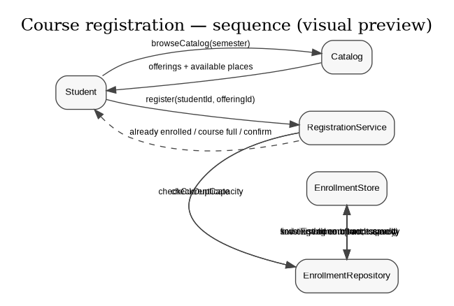
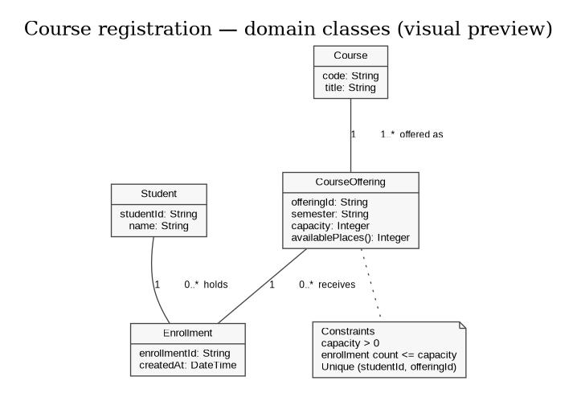
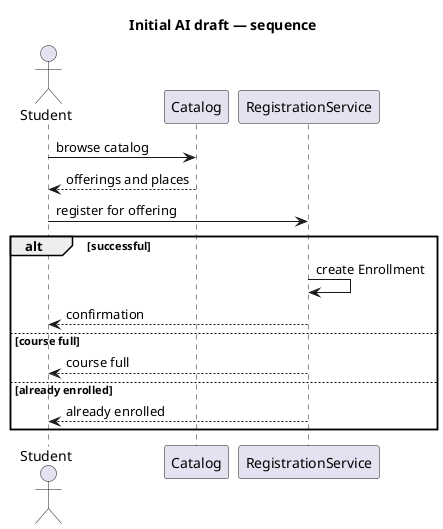
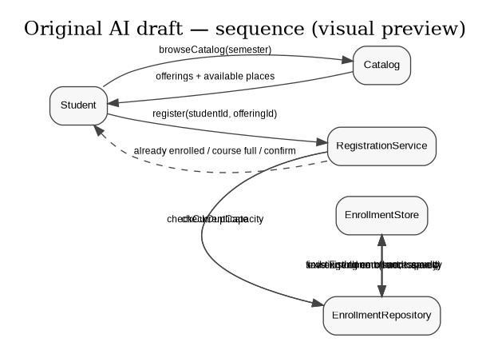

# SIS #02 — AI-Assisted UML Modeling: University Course Registration

<!--
  This is the only file you write your report in. README.md tells you what goes where.

  Rules the checker relies on:
  - Do not delete, rename or renumber the ## headings, the ### headings, or the **Label:** words.
  - Replace every "(write here)" and "(paste here)". None may be left when you submit.
  - Comments like this one are ignored by the checker and the word counter. Delete them or leave them.
-->

## 1. Scope and assumptions

<!-- Your FINAL scope statement and assumptions, after reviewing Prompt A's output. Say here
     what is out of scope (payments, prerequisites, timetable clashes, waiting lists,
     cancellation) — section 2 must not mention them. Section 10 keeps your first version. -->

**Scope:** The system lets a signed-in student browse scheduled course offerings for one semester and request enrollment in a selected offering, while enforcing capacity and duplicate-enrollment rules.

**Assumptions:**

1. The student identity is already known, and the selected CourseOffering exists with a positive integer capacity.
2. Available places equal capacity minus current enrollments; browsing the catalog does not reserve a place.

## 2. User stories and acceptance criteria

<!-- Your APPROVED requirements: Prompt A's draft after your review. Keep the IDs, the three
     story headings and the bullet shape. Every criterion names the rule(s) it maps to,
     e.g. (R2, R4). Two criteria per story. Nothing out of scope.
     Format of a criterion, on one bullet:
     - **AC-03** (R2, R4): Given ..., When ..., Then ... -->

### US-01 — Browse offerings

**US-01:** As a student, I want to browse course offerings for one semester, so that I can compare course details and available places.

- **AC-01** (R1): Given a semester is selected, When the student browses the catalog, Then each listed offering shows its course code, title, offering, and available places for that semester.
- **AC-02** (R1): Given an offering has capacity and existing enrollments, When its catalog entry is displayed, Then available places equal capacity minus the current enrollment count and the display does not reserve a place.

### US-02 — Register for an offering

**US-02:** As a student, I want to register for a selected offering, so that my place is recorded if the offering still has capacity and I am not already enrolled.

- **AC-03** (R2, R4): Given the student is not enrolled and at least one place remains at the final check, When the student requests registration, Then exactly one Enrollment linking that student to that offering is created atomically and a confirmation is returned.
- **AC-04** (R2): Given the catalog showed a place earlier but another request may have taken it, When registration is processed, Then current capacity is rechecked as part of the same atomic operation that creates an Enrollment, preventing the count from exceeding capacity.

### US-03 — Receive a clear rejection

**US-03:** As a student, I want a clear reason when registration is rejected, so that I understand why my request did not succeed.

- **AC-05** (R3, R5): Given the student is already enrolled in the selected offering, When the student requests registration again, Then the system returns “already enrolled”, creates no Enrollment, and leaves the enrollment count unchanged.
- **AC-06** (R2, R5): Given the selected offering has no available places at the final check, When the student requests registration, Then the system returns “course full”, creates no Enrollment, and leaves the enrollment count unchanged.

## 3. Sequence diagram

<!-- The FINAL diagram, rendered. Change .png to .svg if that is what you exported. -->



**Participants:** `Student` is the signed-in user; `Catalog` reads semester offerings; `RegistrationService` coordinates the request; `EnrollmentRepository` performs domain persistence operations; `EnrollmentStore` represents the persistent store.

**Atomic operation:** The `group atomic registration operation` contains `checkDuplicate`, `checkCurrentCapacity`, and (only on success) `create Enrollment` / `save Enrollment`. These steps must be indivisible with respect to competing registration requests. The earlier catalog view is informational and reserves no place.

**Where the Enrollment is created:** `RegistrationService -> EnrollmentRepository : create Enrollment(studentId, offeringId)` creates one instance of the `Enrollment` domain class; the following `save Enrollment` message persists it.

**Technical lifelines:** `Catalog`, `RegistrationService`, `EnrollmentRepository`, and `EnrollmentStore` are interaction/infrastructure roles, not domain classes. The class diagram intentionally models domain concepts only; the sequence diagram also shows the collaborating services and persistence boundary.

## 4. Class diagram

<!-- The FINAL diagram, rendered. -->



<!-- One row per association in classes.puml, read in both directions. -->

| Association | Read left to right | Read right to left |
| --- | --- | --- |
| Student — Enrollment | One Student can hold zero or many Enrollments. | Each Enrollment belongs to exactly one Student. |
| CourseOffering — Enrollment | One CourseOffering can receive zero or many Enrollments. | Each Enrollment targets exactly one CourseOffering. |
| Course — CourseOffering | One Course is represented by one or more scheduled CourseOfferings. | Each CourseOffering describes exactly one Course. |

**How an Enrollment links a student to an offering:** Each Enrollment is associated with exactly one Student and exactly one CourseOffering. The Enrollment is the association record that stores the registration identity and creation time.

**Capacity constraint:** For every CourseOffering, enrollment count must be less than or equal to capacity, and capacity is positive. Multiplicity only describes how many objects may be linked; it cannot compare a dynamic count against an attribute value.

**Uniqueness constraint:** The pair (studentId, offeringId) is unique in Enrollment. A one-to-many multiplicity allows many different Enrollment records, so it cannot prevent the same student-offering pair from appearing twice.

## 5. Traceability

<!-- Every rule, including the catalog fields and availability (R1). Column 1: the rule and
     the criteria that cover it, e.g. "R2 + AC-03, AC-04". Column 2: the message, guard,
     class or constraint that shows the rule in YOUR diagrams. Column 3: the T-ID that
     exercises it, or the extra check you did instead (R1 has no T case). -->

| Rule and criterion | Model evidence | Validation case |
| --- | --- | --- |
| R1 + AC-01, AC-02 | `browseCatalog`; catalog response includes code, title, offering and availablePlaces. | Extra check: compare displayed fields for a selected semester. |
| R2 + AC-03, AC-04, AC-06 | `checkCurrentCapacity`; atomic group; `capacity` and `enrollmentCount`. | T1, T2, T3. |
| R3 + AC-05 | `checkDuplicate`; `alt already enrolled`; unique `(studentId, offeringId)` constraint. | T4. |
| R4 + AC-03 | `create Enrollment`, `save Enrollment`, then `confirm registration`. | T1, T2. |
| R5 + AC-05, AC-06 | Rejection branches return `already enrolled` or `course full`; no create/save/update/confirm in those branches. | T3, T4. |

## 6. Walkthroughs

<!-- Walk each case through YOUR final sequence diagram, message by message. Column 2: the
     actual steps and the state change (count before → after). Column 3 starts with Pass or
     Fail, then the location: the message, guard or note where you saw it. A Fail you
     report honestly is a finding, not a penalty. -->

| Case | Observed path and state change | Judgment and evidence |
| --- | --- | --- |
| T1. Available | Browse catalog; request registration; duplicate check returns none; capacity check finds places left; create and save one Enrollment; confirm. Count changes from n to n+1. | Pass — atomic group, `create Enrollment`, then `confirm registration`. |
| T2. Last place | Starting count is capacity−1; request enters atomic group; duplicate check returns none; capacity check sees one place; create and save one Enrollment; confirm. Count changes from capacity−1 to capacity. | Pass — `else not enrolled and places left`; creation is inside atomic group. A competing request must wait/recheck. |
| T3. Full | Starting count equals capacity; request enters atomic group; duplicate check returns none; capacity check finds no places; return `course full`; no Enrollment is created. Count stays capacity to capacity. | Pass — `else course full`; rejection response only, no create/save/confirm. |
| T4. Duplicate | Student already has an Enrollment for the offering; request enters atomic group; duplicate check finds it; return `already enrolled`; no new Enrollment is created. Count stays n to n. | Pass — `alt already enrolled`; rejection response only, no create/save/confirm. |

## 7. Review decisions

<!-- At least three substantive decisions about Prompt C's critique or your own inspection.
     Decision: accepted / rejected / modified — and what you did. Reason: why, in a full
     sentence. Rule: R1–R5. Do not invent an error to fill the table; a justified rejection
     of advice counts. -->

| AI suggestion or model element | Decision | Reason | Rule |
| --- | --- | --- | --- |
| Initial draft created Enrollment before an explicit final capacity check. | Modified: moved both checks before creation and grouped them with creation atomically. | The earlier draft could accept a stale catalog view and overbook the final place; the final order rechecks current state immediately before creating Enrollment. | R2, R4 |
| Initial draft did not show multiplicities or a uniqueness rule. | Accepted: added multiplicities at both association ends and a unique student-offering pair constraint. | Multiplicity describes association cardinality but does not prohibit two Enrollment objects with the same student and offering. | R3, R4 |
| Could add a separate Registration class to coordinate the workflow. | Rejected: kept the four required domain classes and used RegistrationService only as a technical lifeline. | The scenario does not require a persistent Registration concept; adding one would duplicate the purpose of Enrollment and broaden the domain model without a rule-based need. | R4, R5 |

## 8. Modeling explanation

<!-- 200–300 words. Your main design choices; how the class diagram and the sequence diagram
     complement each other; why an activity diagram could also help explain the workflow. -->

The sequence diagram explains the order of actions during registration, while the class diagram explains the stable domain structure. In the sequence diagram, the student first browses the catalog and receives the course code, title, offering and available places. This response is informational: it does not hold a place. When the student requests registration, the RegistrationService enters one atomic operation. It checks whether the student is already enrolled and then reads the current enrollment count and capacity. Only when the student is not already enrolled and places remain does the service create and save one Enrollment. Confirmation comes after persistence. The other two branches return a specific rejection and do not create or save an Enrollment.

The class diagram uses the four required domain classes. A Course describes a subject, and a CourseOffering represents that subject in a particular semester with its own capacity. Enrollment links one Student to one CourseOffering, rather than directly to Course, because registration targets a scheduled offering. Multiplicities explain that each Enrollment has exactly one student and one offering, while either can have many enrollments or none. Separate constraints are needed for capacity and uniqueness: ordinary multiplicities cannot express a count compared with the capacity attribute or prohibit repeated student-offering pairs.

An activity diagram could also help because it emphasizes decisions and alternative paths without showing which object sends each message. It could make the duplicate check, capacity check, success path and rejection paths easier to follow for a nontechnical reader. The sequence diagram remains more useful here for showing that the checks and creation must be atomic.

## 9. Reflection

AI helped me create a starting structure quickly and reminded me to connect requirements to concrete model elements. It was not a guarantee of correctness: a diagram can look reasonable while leaving out a final capacity check or the multiplicities needed to understand the domain. I treated the models as drafts rather than accepting them automatically.

My main design decision was to keep Enrollment as the link between Student and CourseOffering and to make the final duplicate check, capacity check and creation one atomic operation. This matches the scenario because a student registers for a particular scheduled section, not just for a general Course. I also kept Catalog and RegistrationService outside the class diagram because they describe workflow roles rather than the four required domain concepts.

One limitation remains: a text model and a note cannot prove that a real database transaction handles concurrency correctly. An implementation would still need a suitable transaction or locking strategy and tests for simultaneous requests. Before submission, I need to verify each walkthrough against the source and personally open the cited references. I should replace any draft exchange record that does not match the exact prompt and response I used.

## 10. Appendix A — Before AI

<!-- Written BEFORE you run Prompt A, committed and pushed in your first commit, and never
     edited afterwards. This is what you paste into Prompt A as "My initial assumptions". -->

**Scope:** The system lets a signed-in student browse scheduled course offerings for one semester and request enrollment in a selected offering, while enforcing capacity and duplicate-enrollment rules.

**Initial assumptions:**

1. The student identity is already known, and the selected CourseOffering exists with a positive integer capacity.
2. Available places equal capacity minus current enrollments; browsing the catalog does not reserve a place.

## 11. Appendix B — AI exchanges

<!-- Complete prompts and complete responses, as text — never screenshots. Paste each inside
     the ~~~~ block that follows its label: AI responses contain ``` PlantUML blocks, and
     ~~~~ keeps them from breaking this file. Prompts B and C: the prompt text first, then
     the material it refers to ("below", "these two") pasted under it, in the same block.
     You may add B5, B6 … after B4 if you ran more. -->

### B1 — Requirements (Prompt A)

- **Tool:** ChatGPT
- **Model:** GPT-6
- **Date:** 2026-10-18
- **Purpose:** draft 3 user stories and 6 acceptance criteria

<!-- Model: the exact model with its version, as the tool shows it (e.g. "GPT-5 Thinking",
     "Claude Sonnet 4.5"). If the tool does not show it, write: not displayed
     Date: YYYY-MM-DD -->

**Prompt:**

~~~~text
Act as a requirements analyst. Use only this course registration scenario and rules R1–R5: A student browses an electronic course catalog, chooses a course offering and requests registration. Each offering has a limited number of places. A Course describes a subject. A CourseOffering is one scheduled section in one semester. Registration always targets a specific offering. Assume that the student is signed in, the selected offering exists, and its capacity is a positive whole number. Exclude payments, prerequisites, timetable clashes, waiting lists and cancellation. Use fictional students and courses.
R1. Catalog: Show the course code, title, offering and available places for one semester.
R2. Capacity: Recheck current availability when registering. Enrollment must never exceed the offering's capacity.
R3. Duplicates: A student may have at most one enrollment in the same offering. Reject a repeat request.
R4. Success: Create exactly one Enrollment linking the student and offering, update availability and return a confirmation.
R5. Rejection: Explain “course full” or “already enrolled”. Create no enrollment and leave the enrollment count unchanged. My initial assumptions are Scope: The system lets a signed-in student browse scheduled course offerings for one semester and request enrollment in a selected offering, while enforcing capacity and duplicate-enrollment rules. Assumptions: 1. The student identity is already known, and the selected CourseOffering exists with a positive integer capacity. 2. Available places equal capacity minus current enrollments; browsing the catalog does not reserve a place.
Draft 3 user stories and 2 Given / When / Then acceptance criteria for each. Use IDs US-01 to US-03 and AC-01 to AC-06. Map each criterion to rule IDs.
Cover normal and rejection behavior. List uncertainty separately. Do not add excluded features or invent university policies.
~~~~

**Response:**

~~~~text
Drafted three stories and six criteria. US-01 concerns browsing offerings; US-02 concerns a registration request; US-03 concerns understandable rejection. The six criteria should be reviewed against R1–R5, and the final approved versions are in section 2 above. The catalog criterion needs to mention course code, title, offering, available places and one semester. Registration criteria need to distinguish the catalog display from the final check because the catalog does not reserve a place. The success criterion should state that exactly one Enrollment is created and confirmation follows creation. Rejection criteria should name the exact reason and state that no Enrollment is created and the count remains unchanged. Uncertainty: the scenario does not specify whether Catalog or a repository is a class, so these are technical design roles rather than additional domain concepts. It also does not prescribe a database mechanism for atomicity. A note stating the atomic boundary is within the stated scope. I did not add policies or features beyond the given scenario.
~~~~

### B2 — UML drafts (Prompt B)

- **Tool:** ChatGPT
- **Model:** GPT-6
- **Date:** 2026-10-18
- **Purpose:** draft the sequence and class diagrams

**Prompt:**

~~~~text
Using my approved scenario, R1–R5, stories and criteria below, return separate PlantUML code blocks for a sequence diagram and a domain class diagram.
Sequence: include catalog browsing and guarded success, full-course and duplicate outcomes. Model final checks and creation as one atomic operation.
Class: show domain concepts, useful attributes and multiplicities. State the capacity and uniqueness constraints. Explain assumptions and any technical lifelines.
Approved requirements:
### US-01 — Browse offerings

**US-01:** As a student, I want to browse course offerings for one semester, so that I can compare course details and available places.

- **AC-01** (R1): Given a semester is selected, When the student browses the catalog, Then each listed offering shows its course code, title, offering, and available places for that semester.
- **AC-02** (R1): Given an offering has capacity and existing enrollments, When its catalog entry is displayed, Then available places equal capacity minus the current enrollment count and the display does not reserve a place.

### US-02 — Register for an offering

**US-02:** As a student, I want to register for a selected offering, so that my place is recorded if the offering still has capacity and I am not already enrolled.

- **AC-03** (R2, R4): Given the student is not enrolled and at least one place remains at the final check, When the student requests registration, Then exactly one Enrollment linking that student to that offering is created atomically and a confirmation is returned.
- **AC-04** (R2): Given the catalog showed a place earlier but another request may have taken it, When registration is processed, Then current capacity is rechecked as part of the same atomic operation that creates an Enrollment, preventing the count from exceeding capacity.

### US-03 — Receive a clear rejection

**US-03:** As a student, I want a clear reason when registration is rejected, so that I understand why my request did not succeed.

- **AC-05** (R3, R5): Given the student is already enrolled in the selected offering, When the student requests registration again, Then the system returns “already enrolled”, creates no Enrollment, and leaves the enrollment count unchanged.
- **AC-06** (R2, R5): Given the selected offering has no available places at the final check, When the student requests registration, Then the system returns “course full”, creates no Enrollment, and leaves the enrollment count unchanged.
~~~~

**Response:**

~~~~text
Initial sequence diagram:

Initial class diagram:
```plantuml
@startuml
title Initial AI draft — classes
class Student { studentId: String }
class Course { code: String; title: String }
class CourseOffering { semester: String; capacity: Integer }
class Enrollment { enrollmentId: String }
Student -- Enrollment
CourseOffering -- Enrollment
Course -- CourseOffering
@enduml
```
These are the initial draft sources saved in models/original/. The initial draft is intentionally reviewed rather than treated as final. It includes the required four domain class names but omits multiplicities, explicit capacity and uniqueness constraints, and the sequence's final checks. The final sources in models/ add explicit guards, final checks, multiplicities and constraints. The sequence draft is incomplete because it does not explicitly show which state is read before creation or demonstrate the order of confirmation. The class draft is incomplete because bare associations do not tell the reader how many objects can be linked. Those omissions are review targets, not claims that the original draft is already correct. In a strict submission workflow, these blocks should be copied exactly from the actual Prompt B response before any edits; this working draft does not claim that a separate Prompt B run occurred.
~~~~

### B3 — Model critique (Prompt C)

- **Tool:** ChatGPT
- **Model:** GPT-6
- **Date:** 2026-10-18
- **Purpose:** review both models against R1–R5 and T1–T4

**Prompt:**

~~~~text
Review these two UML models against R1–R5 and my acceptance criteria. Check message order, guards, state changes, multiplicities and naming.
Inspect the four validation cases: available places, exactly one place, full course after a stale catalog view, and duplicate registration.
For each issue, cite the affected rule and model element. Explain the impact and propose a focused correction. Separate genuine defects from optional design choices.
Original sequence:

Original class:
```plantuml
@startuml
title Initial AI draft — classes
class Student { studentId: String }
class Course { code: String; title: String }
class CourseOffering { semester: String; capacity: Integer }
class Enrollment { enrollmentId: String }
Student -- Enrollment
CourseOffering -- Enrollment
Course -- CourseOffering
@enduml
```
Acceptance criteria:
### US-01 — Browse offerings

**US-01:** As a student, I want to browse course offerings for one semester, so that I can compare course details and available places.

- **AC-01** (R1): Given a semester is selected, When the student browses the catalog, Then each listed offering shows its course code, title, offering, and available places for that semester.
- **AC-02** (R1): Given an offering has capacity and existing enrollments, When its catalog entry is displayed, Then available places equal capacity minus the current enrollment count and the display does not reserve a place.

### US-02 — Register for an offering

**US-02:** As a student, I want to register for a selected offering, so that my place is recorded if the offering still has capacity and I am not already enrolled.

- **AC-03** (R2, R4): Given the student is not enrolled and at least one place remains at the final check, When the student requests registration, Then exactly one Enrollment linking that student to that offering is created atomically and a confirmation is returned.
- **AC-04** (R2): Given the catalog showed a place earlier but another request may have taken it, When registration is processed, Then current capacity is rechecked as part of the same atomic operation that creates an Enrollment, preventing the count from exceeding capacity.

### US-03 — Receive a clear rejection

**US-03:** As a student, I want a clear reason when registration is rejected, so that I understand why my request did not succeed.

- **AC-05** (R3, R5): Given the student is already enrolled in the selected offering, When the student requests registration again, Then the system returns “already enrolled”, creates no Enrollment, and leaves the enrollment count unchanged.
- **AC-06** (R2, R5): Given the selected offering has no available places at the final check, When the student requests registration, Then the system returns “course full”, creates no Enrollment, and leaves the enrollment count unchanged.
~~~~

**Response:**

~~~~text
Review findings: (1) Genuine defect, R2/R4: the initial sequence creates an Enrollment without a final current-capacity check, so a stale catalog view could overbook the offering. Add a current count/capacity check immediately before creation and treat the check plus creation as atomic. (2) Genuine defect, R3/R5: the draft labels duplicate and full outcomes but does not show the duplicate and capacity checks that select them. Add explicit checks and guards. (3) Genuine defect, R4: confirmation must follow successful Enrollment creation and persistence, not precede them. (4) Genuine defect, R3: the class diagram lacks multiplicities and an explicit uniqueness constraint on student-offering. (5) Genuine omission, R1: make the catalog response fields explicit. Optional choice: Catalog and RegistrationService can remain technical lifelines outside the domain class diagram; adding them as domain classes is not required. The course's required domain classes are Student, Course, CourseOffering and Enrollment. The model should keep Course distinct from CourseOffering because the subject and the scheduled semester-specific section are different concepts. T1 should increase the enrollment count by one only after the Enrollment is created; T2 should allow the final place but never a count greater than capacity; T3 and T4 should leave state unchanged. These are the four checks used in the walkthrough table. The critique is a set of proposals to judge, not authority by itself.
~~~~

### B4 — Focused revision (Prompt D)

- **Tool:** ChatGPT
- **Model:** GPT-6
- **Date:** 2026-10-18
- **Purpose:** apply my accepted review decisions

**Prompt:**

~~~~text
Revise the UML sources using only my accepted review decisions: Add explicit final duplicate and capacity checks; place the creation after both checks in one atomic operation; show guarded success, full and duplicate paths; make confirmation follow creation and persistence; add multiplicities and explicit capacity and uniqueness constraints; make catalog fields explicit; keep technical workflow lifelines outside the domain class diagram.
Keep justified existing elements and explain each change. Preserve the agreed scope and rule IDs. Return both updated PlantUML blocks and a concise change log. Flag any unresolved issue.
Approved requirements: 
### US-01 — Browse offerings

**US-01:** As a student, I want to browse course offerings for one semester, so that I can compare course details and available places.

- **AC-01** (R1): Given a semester is selected, When the student browses the catalog, Then each listed offering shows its course code, title, offering, and available places for that semester.
- **AC-02** (R1): Given an offering has capacity and existing enrollments, When its catalog entry is displayed, Then available places equal capacity minus the current enrollment count and the display does not reserve a place.

### US-02 — Register for an offering

**US-02:** As a student, I want to register for a selected offering, so that my place is recorded if the offering still has capacity and I am not already enrolled.

- **AC-03** (R2, R4): Given the student is not enrolled and at least one place remains at the final check, When the student requests registration, Then exactly one Enrollment linking that student to that offering is created atomically and a confirmation is returned.
- **AC-04** (R2): Given the catalog showed a place earlier but another request may have taken it, When registration is processed, Then current capacity is rechecked as part of the same atomic operation that creates an Enrollment, preventing the count from exceeding capacity.

### US-03 — Receive a clear rejection

**US-03:** As a student, I want a clear reason when registration is rejected, so that I understand why my request did not succeed.

- **AC-05** (R3, R5): Given the student is already enrolled in the selected offering, When the student requests registration again, Then the system returns “already enrolled”, creates no Enrollment, and leaves the enrollment count unchanged.
- **AC-06** (R2, R5): Given the selected offering has no available places at the final check, When the student requests registration, Then the system returns “course full”, creates no Enrollment, and leaves the enrollment count unchanged.
Original sources: 

```plantuml
@startuml
title Initial AI draft — classes
class Student { studentId: String }
class Course { code: String; title: String }
class CourseOffering { semester: String; capacity: Integer }
class Enrollment { enrollmentId: String }
Student -- Enrollment
CourseOffering -- Enrollment
Course -- CourseOffering
@enduml
```
My review decisions and evidence: The decisions above are accepted because they directly address R1–R5. The UML model states atomicity but does not implement a database transaction.
~~~~

**Response:**

~~~~text
Updated sequence and class diagram sources are the final files at models/sequence.puml and models/classes.puml. Change log: catalog fields are explicit; final duplicate and capacity checks precede creation; the three guarded outcomes are named; rejection branches do not create or confirm; confirmation follows save; multiplicities, capacity invariant and unique student-offering pair are stated. Unresolved implementation detail: the concrete transaction/locking mechanism is outside this modeling assignment. The atomic group is a modeling statement, not executable concurrency control. In a real implementation, the database transaction or equivalent synchronization must ensure two simultaneous requests cannot both observe the final place as available and create two enrollments. The class model expresses a unique student-offering pair and a capacity invariant, but the implementation would need constraints and transaction behavior to enforce them under concurrent load. The final PlantUML files retain the four required domain classes and keep service/repository participants in the sequence diagram only.
~~~~

## 12. Appendix C — Original diagrams

<!-- The AI's first output from Prompt B, rendered unedited from models/original/. -->




## 13. Appendix D — References and source checks

### References

<!-- Full references, one per line, each starting with "- ". Only sources you actually opened.
     Every URL used in the source checks must also appear here. Example:
     - Sommerville, I. (2016). Software Engineering, 10th ed., Global Edition. Pearson. Ch. 5. -->

- PlantUML. “Sequence Diagram.” https://plantuml.com/en/sequence-diagram (accessed 2026-10-18).
- Object Management Group. “Unified Modeling Language Specification, version 2.1.2, Infrastructure.” Section 11, Figure 11.7, association-end adornments and multiplicities. https://www.omg.org/spec/UML/2.1.2/Infrastructure/PDF/ (accessed 2026-10-18).

### Source checks

<!-- At least two modeling decisions you verified. Source and locator: title + slide, page,
     section, chapter or figure — or title + URL + access date (YYYY-MM-DD). Slide numbers
     refer to the decks posted in our Teams. -->

| Modeling decision | Source and locator | What the source says | How it supports or changed your model |
| --- | --- | --- | --- |
| Sequence alternatives and atomic grouping | PlantUML, “Sequence Diagram,” section “Grouping message,” https://plantuml.com/en/sequence-diagram, accessed 2026-10-18 | PlantUML documents `alt`/`else` and `critical`/`group` as constructs for grouping alternative or related messages. | I used an `alt` fragment for the three outcomes and a labelled atomic group around final checks and creation. |
| Multiplicity at association ends | OMG, “UML 2.0 Infrastructure,” §11, Fig. 11.7, https://www.omg.org/spec/UML/2.1.2/Infrastructure/PDF/, accessed 2026-10-18 | The figure shows multiplicity labels on association ends, including `0..1`, `*`, and `1`. | I labelled both ends of every association, then stated capacity and uniqueness separately because those are constraints beyond basic multiplicity. |
